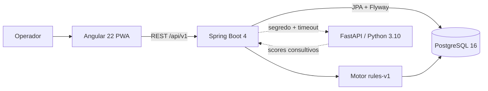
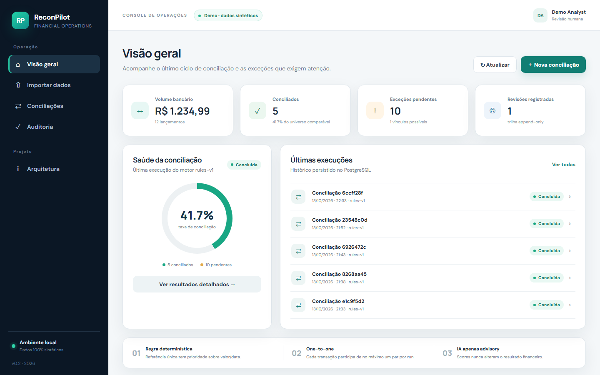
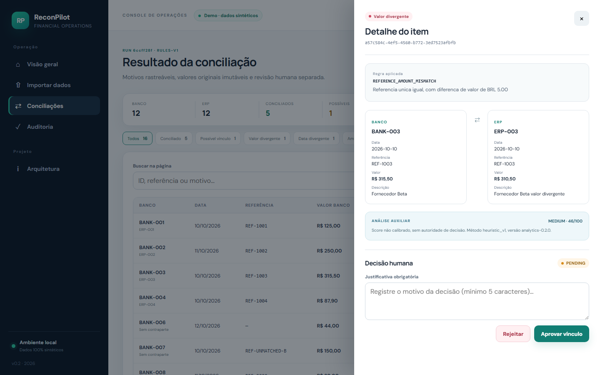
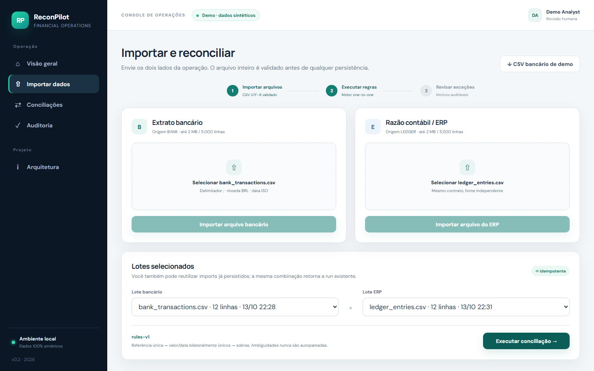
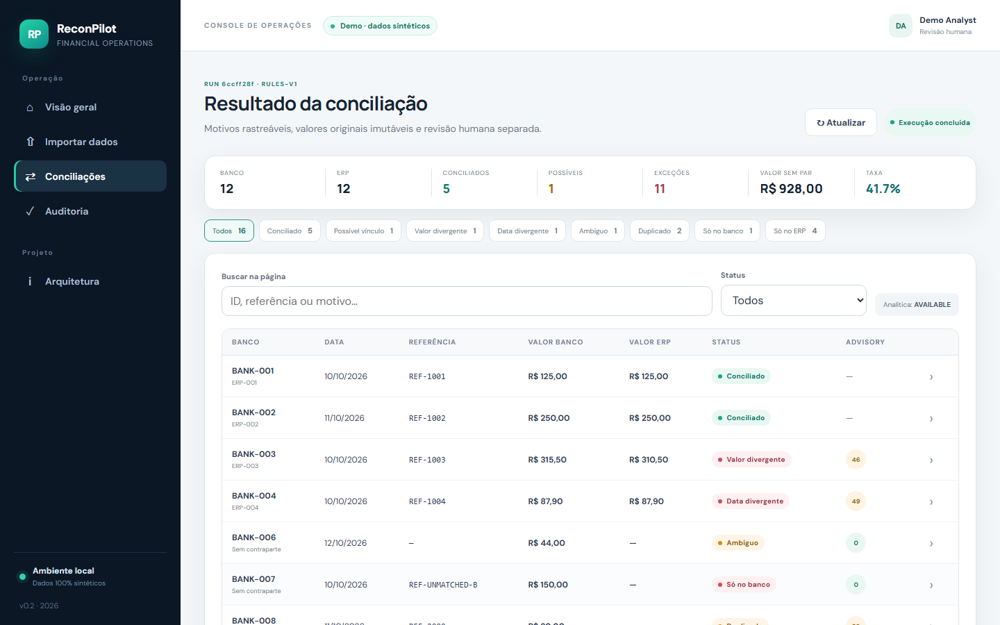
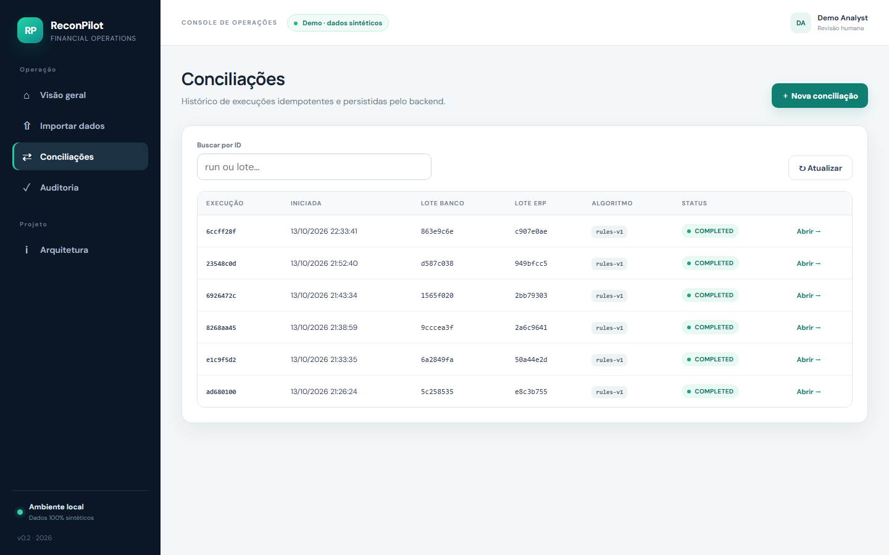
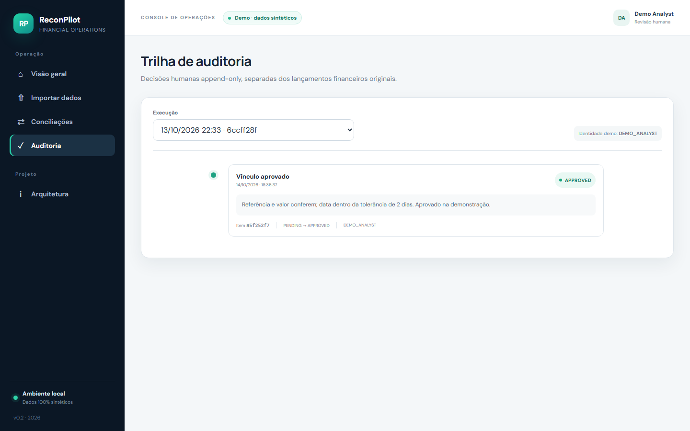

# 🧾 ReconPilot AI — Conciliação financeira determinística, do CSV à decisão auditável

### Angular 22 · TypeScript · Java 21 · Spring Boot 4 · PostgreSQL 16 · Flyway · Python 3.10 · FastAPI · scikit-learn · Docker · PWA

[](https://github.com/Yuri-Fernando/reconpilot-ai/actions/workflows/ci.yml)


 

## 🟡 Status — MVP técnico funcional

**Núcleo validado localmente.** Importação CSV, motor de conciliação `rules-v1`, persistência em PostgreSQL 16, API REST, console Angular (PWA) e serviço Python consultivo, com **56 testes automatizados passando** (40 Java · 7 Angular · 9 Python) e fluxo ponta a ponta executado com banco real. Dados 100% sintéticos; sem autenticação, deploy ou controles de produção.

| Área | Estado | Evidência |
|---|---|---|
| Motor de conciliação `rules-v1` | ✅ Implementado e testado | 15 testes unitários + oráculo de 16 casos |
| Importação CSV e persistência | ✅ Implementado e testado | 7 testes de contrato CSV + integração com PostgreSQL 16 (Testcontainers) |
| Revisão humana e auditoria | ✅ Implementado e testado | Evento append-only; decisão concorrente única, testada em banco real |
| Console Angular / PWA | ✅ Implementado | 7 testes Vitest, build de produção, capturas reais (seção Evidências) |
| Serviço Python consultivo | ✅ Implementado (opcional) | 9 testes pytest + 9 testes de contrato Java↔Python; imagem Docker construída |
| Autenticação, deploy, Android/iOS | ⏳ Planejado | Fora do MVP — ver seção Roadmap |

---

## Descrição / Contexto

O **ReconPilot AI** é uma plataforma local de **conciliação financeira**: recebe o extrato bancário e o razão contábil (ERP) em CSV, pareia os lançamentos com regras determinísticas, explica cada exceção e registra a decisão humana em uma trilha de auditoria que ninguém edita depois.

Conciliar é conferir se o que o banco registrou bate com o que a empresa anotou. Na prática as duas listas divergem — duplicidades, datas deslocadas, centavos errados, itens que só existem de um lado — e a conferência costuma ser manual. O projeto automatiza o pareamento **sem esconder dúvida**: o que o motor não consegue afirmar vira exceção explicada para uma pessoa decidir.

Um serviço Python independente pode dar um *score* consultivo às exceções (heurística estatística e, opcionalmente, Isolation Forest). Esse score **nunca** participa da decisão de pareamento.

É uma peça de portfólio para demonstrar engenharia full-stack Java/Angular com persistência real, testes e análise auxiliar auditável. Os dados são sintéticos e não há integração bancária.

---

## 🧭 Origem do Projeto

O projeto partiu de uma pergunta de engenharia: *como automatizar conciliação sem perder a capacidade de explicar e auditar cada decisão?* As conclusões que definiram o desenho:

1. **Resultado reprodutível e explicável.** O motor é por regras, versionado (`rules-v1`) e gravado em cada execução; as mesmas entradas geram sempre a mesma saída, inclusive com a ordem de entrada embaralhada (testado).
2. **Na dúvida, não parear.** Ambiguidade, duplicidade e candidatos concorrentes viram exceção; nunca há autopareamento.
3. **IA só como apoio.** Os scores ficam em tabela separada e o motor Java nunca os consulta. Se o Python estiver desligado, lento ou inválido, a conciliação continua e a análise fica `DISABLED`/`UNAVAILABLE`.
4. **Dados originais imutáveis.** Uma decisão humana é um evento *append-only* com justificativa; a transação importada nunca é alterada.
5. **Escrita financeira *fail-closed*.** Sem PostgreSQL, a escrita falha — não existe resultado fictício.
6. **Web primeiro.** PWA validada antes de qualquer trabalho mobile; Android/iOS ficam como roadmap.

O desenvolvimento seguiu marcos com *gates* de evidência — só se avança com testes executados: **M0** baseline e toolchain · **M1** domínio e motor · **M2** persistência e API · **M3** console do operador · **M4** evidências e documentação.

---

## 🎯 Objetivo

- Importar CSV com contrato estrito e rejeitar reimportação do mesmo arquivo (`409 DUPLICATE_IMPORT`).
- Conciliar com **no máximo um par por transação** em cada execução, com tolerância de 2 dias e valor exato.
- Explicar cada resultado com um `reason_code` e uma frase legível.
- Registrar revisão humana auditável sem tocar nos valores originais.
- Manter a análise Python opcional, separada e sem autoridade de decisão.
- Operar tudo por um console web (upload real, filtros, detalhe, auditoria).

---

## 🔬 Linha de Desenvolvimento

- **Domínio financeiro:** `BigDecimal`, moeda BRL, centavos, valores negativos, chave de negócio (referência + valor + data + moeda).
- **Motor determinístico:** pareamento por referência bilateralmente única, depois por valor/data, com sobras classificadas.
- **Persistência:** JPA + Flyway (3 migrations), schema `app`, restrições de unicidade e *checks* no banco.
- **Integração server-to-server:** Java → FastAPI com segredo interno, *timeout*, HTTP/1.1 e validação defensiva da resposta.
- **Front-end:** Angular standalone com *signals*, rotas *lazy*, PWA sem cache de API.
- **Qualidade:** testes de unidade, contrato, integração com Testcontainers, concorrência e oráculo de dataset.

---

## 🏗️ Arquitetura



### Módulos

| Módulo | Função | Teste |
|---|---|---|
| `ReconciliationEngine` | Motor `rules-v1`: duplicados, referência única, valor/data, sobras | `ReconciliationEngineTest` (15) · `DatasetOracleTest` (1) |
| `CsvParser` | Contrato CSV estrito: UTF-8, cabeçalho exato, `;`, duas casas, BRL, limites | `CsvParserTest` (7) |
| `ImportService` | Importação transacional, SHA-256 do arquivo, idempotência | `ReconciliationPostgresIntegrationTest` |
| `ReviewService` | Decisão humana append-only com lock pessimista | `ReconciliationPostgresIntegrationTest` (concorrência) |
| `AnalyticsService` · `HttpAnalyticsClient` | Cliente Java → Python e validação da resposta | `HttpAnalyticsClientContractTest` (5) · `AnalyticsServiceValidationTest` (4) |
| `ApiExceptionHandler` | Erros tipados (`code`, `traceId`); 4xx para erro do cliente | `ApiExceptionHandlerTest` (6) |
| `ai-service/app/scoring.py` | Score heurístico (MAD) + Isolation Forest opcional | `ai-service/tests/test_analytics.py` (9) |
| `frontend/src/app` | Console do operador (6 telas, cliente HTTP, PWA) | 7 testes Vitest em 4 arquivos |

### Fronteiras de falha

| Situação | Comportamento |
|---|---|
| CSV inválido | Nenhuma linha é persistida |
| PostgreSQL indisponível | A escrita financeira falha; não há resultado fictício |
| Python desligado, lento ou com contrato inválido | A execução segue válida; análise `DISABLED`/`UNAVAILABLE` |
| Mesmo CSV reenviado para a mesma origem | `409 DUPLICATE_IMPORT`, sem duplicar linhas |
| Duas decisões simultâneas no mesmo item | Exatamente uma é aceita; a outra recebe `REVIEW_NOT_ALLOWED` |

Detalhes e decisões em [docs/ARCHITECTURE.md](docs/ARCHITECTURE.md).

---

## ⚙️ Funcionamento

1. **Importar.** O operador envia `bank_transactions.csv` e `ledger_entries.csv`. O arquivo inteiro é validado antes de persistir; o SHA-256 impede reimportação.
2. **Excluir duplicados.** Lançamentos com a mesma chave de negócio (referência + valor + data + moeda) saem do pareamento como `DUPLICATE`.
3. **Parear por referência.** Se a referência é única nos dois lados, forma-se um par; valor, moeda e data definem o resultado:

   | Resultado | Condição |
   |---|---|
   | `MATCHED` | Valor igual e datas até 2 dias de diferença (confiança 1,000) |
   | `DATE_MISMATCH` | Referência e valor iguais, datas a mais de 2 dias |
   | `AMOUNT_MISMATCH` | Referência única igual, valor diferente |
   | `CURRENCY_MISMATCH` | Referência única igual, moedas diferentes |

4. **Parear o resíduo por valor e data.** Sem referência em comum: valor e moeda exatos e data em ±2 dias, **só se o candidato for único nos dois sentidos** → `POSSIBLE_MATCH` (confiança 0,750, revisão obrigatória).
5. **Classificar as sobras.** Banco sem candidato → `UNMATCHED_BANK`; banco com candidatos concorrentes → `AMBIGUOUS`; ERP sem par → `UNMATCHED_LEDGER`.
6. **Persistir a execução.** A *run* é imutável e idempotente por (lote bancário, lote ERP, versão do algoritmo).
7. **Revisar.** O operador aprova ou rejeita as exceções com justificativa; isso gera um evento append-only.
8. **(Opcional) Pontuar.** Se habilitado, o Python pontua somente as exceções; o resultado fica separado e consultivo.

```text
CSV banco + CSV ERP
      ↓ validação integral + SHA-256
lotes persistidos (PostgreSQL)
      ↓ rules-v1
run imutável: pares + exceções explicadas
      ├─→ (opcional) FastAPI → scores consultivos (tabela separada)
      ↓
revisão humana → evento append-only → trilha de auditoria
```

**Taxa de conciliação** = conciliados ÷ min(linhas do banco, linhas do ERP). **Valor sem par** = soma dos valores absolutos dos itens `UNMATCHED_BANK` e `UNMATCHED_LEDGER`.

---

## 🧠 Verificação

Camadas independentes de prova, todas executadas na revisão v0.2.1:

| Camada | O que prova | Resultado |
|---|---|---|
| Unitário do motor (15) | Regras, centavos, negativos, moedas, ambiguidade, duplicidade, ordem de entrada | ✅ passou |
| **Oráculo humano (1 teste, 16 casos)** | O motor reproduz exatamente o gabarito `datasets/expected_cases.csv` | ✅ passou |
| Contrato CSV (7) | Cabeçalho, UTF-8, decimais, datas, limites, `external_id` único | ✅ passou |
| Integração PostgreSQL 16 + Flyway (1) | Migrations aplicam; run idempotente; `409` de duplicado; decisão concorrente única | ✅ passou |
| Contrato Java↔Python (5 + 4) | Segredo, serialização, *timeout*, 401/422/503, resposta consultiva válida | ✅ passou |
| Handler de erros (6) | 404/405/400/415 para erro do cliente; 500 só para falha inesperada | ✅ passou |
| Python (9) | Saúde, *fail-closed* sem token (503), token inválido (401), ids duplicados e entrada inválida (422), scores em [0, 1], determinismo, nenhuma decisão automática | ✅ passou |
| Angular (7) | Upload multipart e criação de run no cliente HTTP, painel alimentado pelo backend (sem *mocks*), estado financeiro com texto além de cor, formatação BRL sem aritmética binária | ✅ passou |

**Independência do oráculo.** O gabarito foi definido por caso de negócio, à parte do código do motor. O `DatasetOracleTest` importa os dois CSVs, roda o motor e compara, transação a transação, com `expected_cases.csv`.

**Não verificado nesta revisão:** suíte E2E automatizada (as capturas foram geradas com Playwright, mas não há E2E no CI), HTTPS, navegadores além do Chromium, dispositivos móveis, carga e segurança ofensiva.

---

## 🧪 Desenvolvimento Experimental

Fluxo: implementar → executar de verdade → inspecionar a aplicação em execução → corrigir → repetir o fluxo.

### Achados reais (não plantados)

| # | Achado | Como apareceu | Causa real | Correção |
|---|---|---|---|---|
| 1 | `POST` multipart via `127.0.0.1:4200` retornava 403 | E2E com Playwright | Lista de CORS só aceitava `localhost` | Origens configuráveis (`APP_FRONTEND_ORIGINS`) com `localhost` e `127.0.0.1` |
| 2 | `<select>` exibia "Selecione" após o upload | E2E com Playwright | Estado interno selecionava o lote, mas as `option` não refletiam | `[selected]` ligado explicitamente ao *signal* |
| 3 | Validação do Hibernate 7 (`ddl-auto=validate`) com colunas `CHAR` do schema Flyway | Subida do backend contra o PostgreSQL | Colunas `CHAR(n)` do schema (hash, moeda) exigem mapeamento explícito | `@JdbcTypeCode` nas entidades correspondentes |
| 4 | Integração Java → FastAPI | Teste de contrato Java↔Python | O serviço usa *snake_case* e o cliente precisa falar HTTP/1.1 | `@JsonNaming(SnakeCaseStrategy)` nos DTOs e `HttpClient.Version.HTTP_1_1` fixo |
| 5 | CI do backend falharia no Linux | Revisão do repositório | `backend/mvnw` sem bit de execução no git | `git update-index --chmod=+x` |
| 6 | `pip install -r requirements.txt` falhava em Python 3.10 | Resolução de dependências | `numpy 2.3.5` e `scikit-learn 1.8.0` não existem para 3.10 | Pins `2.2.6` e `1.7.2`; `docker build` limpo confirmou |
| 7 | Rota inexistente, método errado e UUID inválido retornavam **500** | Sondagem da API em execução | O *catch-all* `Exception` engolia as exceções do Spring MVC | Handlers 4xx específicos, log com `traceId`, 6 testes |
| 8 | Duas decisões simultâneas geravam **dois** eventos de auditoria | Revisão do `ReviewService` | Leitura do item sem lock | `PESSIMISTIC_WRITE` + teste de concorrência em PostgreSQL real |
| 9 | O gabarito humano nunca era executado por teste | Revisão da cobertura | `expected_cases.csv` só existia como documentação | `DatasetOracleTest` |
| 10 | Teste de contrato oscilava sob carga | Validação com três suítes em paralelo | *Timeout* de 2 s contra o primeiro uso do `HttpClient` | Folga de 10 s nos testes de sucesso; o teste de *timeout* segue em 100 ms |

Decisões de arquitetura registradas em [docs/ARCHITECTURE.md](docs/ARCHITECTURE.md); não há ADRs formais.

---

## 🛠️ Tecnologias

- **Linguagens:** Java 21 · TypeScript · Python 3.10 · SQL
- **Back-end:** Spring Boot 4.1.1 (MVC, Data JPA, Validation, Actuator) · Hibernate 7 · Apache Commons CSV
- **Front-end:** Angular 22 (standalone, signals, rotas *lazy*, service worker) · SCSS
- **Análise auxiliar:** FastAPI · Pydantic · NumPy · scikit-learn (Isolation Forest opcional)
- **Dados:** PostgreSQL 16 · Flyway
- **Infra:** Docker / Docker Compose · GitHub Actions
- **Testes:** JUnit · MockMvc · Testcontainers · MockWebServer · Vitest · pytest · Playwright (capturas)

---

## 📊 Resultados

### Dataset sintético (12 lançamentos de cada lado → 16 itens)

| Status | Itens | Motivo |
|---|---|---|
| `MATCHED` | 5 | Referência, valor e data (inclui tolerância de 2 dias, centavos e valor negativo) |
| `POSSIBLE_MATCH` | 1 | Valor e data únicos nos dois sentidos, sem referência em comum |
| `AMOUNT_MISMATCH` | 1 | Referência única igual, diferença de R$ 5,00 |
| `DATE_MISMATCH` | 1 | Referência e valor iguais, datas a 4 dias |
| `AMBIGUOUS` | 1 | Dois candidatos do ERP concorrentes |
| `DUPLICATE` | 2 | Mesma chave de negócio no extrato |
| `UNMATCHED_BANK` | 1 | Sem lançamento correspondente no ERP |
| `UNMATCHED_LEDGER` | 4 | Sem par bancário selecionado |

- **Taxa de conciliação: 41,7 %** = 5 conciliados ÷ 12 linhas.
- **Valor sem par: R$ 928,00** = 150,00 (banco) + 44,00 + 44,00 + 670,00 + 20,00 (ERP).
- Os números vêm da execução real contra PostgreSQL (`GET /reconciliations/{id}/summary`) e do `ReconciliationPostgresIntegrationTest`.

**Limite da métrica.** O dataset foi desenhado para exercitar casos de borda; a taxa de 41,7 % **não** representa desempenho em dados reais.

### Build do front-end

- Pacote inicial de produção: **304,15 kB** (≈ 83,13 kB de transferência estimada), valores reportados pelo Angular CLI; PWA gerada, sem *warnings*.

---

## 🖼️ Evidências

Capturas geradas com Playwright (Chromium, 1440×900) contra a aplicação em execução, com PostgreSQL real. A decisão exibida na tela de Auditoria foi registrada pela própria interface durante a captura.

<p align="center">
  <a href="docs/screenshots/dashboard.png"></a><br>
  <sub>Visão geral — taxa de conciliação, exceções pendentes e histórico de execuções</sub>
</p>

<p align="center">
  <a href="docs/screenshots/reconciliation-detail.png"></a><br>
  <sub>Detalhe auditável — regra aplicada, valores lado a lado, análise auxiliar e decisão humana com justificativa obrigatória</sub>
</p>

<table align="center">
  <tr>
    <td align="center"><a href="docs/screenshots/imports.png"></a><br><sub>Importar e reconciliar — upload validado e escolha de lotes</sub></td>
    <td align="center"><a href="docs/screenshots/reconciliation-results.png"></a><br><sub>Resultado da conciliação — filtros por status e busca</sub></td>
  </tr>
  <tr>
    <td align="center"><a href="docs/screenshots/reconciliations.png"></a><br><sub>Histórico de execuções idempotentes</sub></td>
    <td align="center"><a href="docs/screenshots/audit.png"></a><br><sub>Trilha de auditoria append-only</sub></td>
  </tr>
</table>

---

## 🚀 Aplicações

- Referência de engenharia para um **motor de conciliação determinístico** com trilha de auditoria e IA estritamente consultiva.
- Base para experimentar novas regras de pareamento (1:N, tolerâncias por conta) sobre um núcleo testado.
- Peça de portfólio para demonstrar integração Java ↔ Angular ↔ PostgreSQL ↔ Python com testes reais.

Não há promessa de uso em produção: faltam autenticação, RBAC e os demais controles listados em Limitações.

---

## 🔭 Visão de Longo Prazo

Tudo abaixo está **planejado**, nada foi implementado:

```text
MVP local validado (hoje)
      ↓
autenticação + RBAC (IdP com JWT validado no Spring)
      ↓
demo HTTPS com Postgres gerenciado (JDBC, schema `app`) e sem dados reais
      ↓
PWA auditada (Lighthouse) e matriz de navegadores/dispositivos
      ↓
Android / iOS via Capacitor (reutilizando o Angular)
      ↓
operação: backups, CI/CD de release, rate limiting, observabilidade
```

---

## 🗺️ Roadmap

- **F0 — Baseline e toolchain** ✅ Concluída — JDK 21, Node, Docker e Python 3.10 verificados.
- **F1 — Domínio e motor `rules-v1`** ✅ Concluída — 15 testes unitários + oráculo de 16 casos.
- **F2 — Persistência e API** ✅ Concluída — Flyway, idempotência, integração com PostgreSQL 16 real.
- **F3 — Console do operador (PWA)** ✅ Concluída — 6 telas, 7 testes Vitest, build de produção.
- **F4 — Sidecar Python consultivo** 🟡 Parcial — integração e testes prontos; circuit breaker e telemetria operacional pendentes.
- **F5 — Autenticação/RBAC e demo HTTPS** ⏳ Planejada
- **F6 — Android via Capacitor** ⏳ Planejada
- **F7 — iOS via Capacitor** ⏳ Planejada
- **F8 — Operação (backups, release, rate limiting)** ⏳ Planejada

Detalhe do plano mobile em [docs/ROADMAP_MOBILE.md](docs/ROADMAP_MOBILE.md).

---

## 🕓 Histórico e Mudanças

| Versão | Data | O que mudou |
|---|---|---|
| v0.2.1 | 2026-10-14 | Correções de CI, dependências Python, erros HTTP e concorrência de revisão; oráculo do dataset em teste; capturas de todas as telas; README padronizado e licença |
| v0.2.0 | 2026-10-14 | MVP: importação CSV, motor `rules-v1`, PostgreSQL/Flyway, API REST, console Angular PWA e sidecar Python |

Detalhes em [CHANGELOG.md](CHANGELOG.md) e evidências em [docs/VALIDATION.md](docs/VALIDATION.md).

---

## 🔮 Próximos Passos

**Concluídos nesta versão ✅**
- Oráculo do dataset em teste automatizado.
- Correção do CI (`mvnw`), dos pins Python e do tratamento de erros HTTP.
- Decisão humana concorrente protegida por lock e testada em PostgreSQL real.
- Capturas reais de todas as telas.

**Dependem de terceiros ⏳**
- Banco gerenciado e hospedagem para uma demo pública com HTTPS.
- Contas de desenvolvedor Google Play / Apple para as etapas mobile.

**Próximos técnicos — o que eu faria numa v2**
- Autenticação e RBAC (hoje o revisor é fixo: `DEMO_ANALYST`).
- Suíte E2E automatizada no CI (Playwright) e auditoria Lighthouse.
- Circuit breaker e telemetria no cliente Java → Python.
- Pareamento 1:N / N:1 e tolerâncias configuráveis por conta.

---

## ▶️ Como rodar localmente

**Pré-requisitos:** JDK 21 (um Java 8 no `PATH` não serve — aponte `JAVA_HOME` para um JDK 21), Node.js compatível com Angular 22 (validado com 24.19), Docker em execução e, para a análise opcional, Python 3.10.

```powershell
# 1) Banco (PostgreSQL 16 em 127.0.0.1:5432)
Copy-Item .env.example .env
docker compose up -d db

# 2) Backend — http://localhost:8080
cd backend
$env:JAVA_HOME = 'C:\caminho\para\jdk-21'; $env:Path = "$env:JAVA_HOME\bin;$env:Path"
$env:DB_PASSWORD = 'dev_only_change_me'     # valor de desenvolvimento do .env.example
.\mvnw.cmd spring-boot:run

# 3) Frontend — http://localhost:4200 (outro terminal)
cd frontend
npm ci
npm start
```

Abra `http://localhost:4200`, vá em **Importar dados** e envie os CSVs de `datasets/`. O proxy do Angular encaminha `/api/v1` para `http://localhost:8080`.

**Análise Python opcional:**

```powershell
$Py310 = "$env:LOCALAPPDATA\Programs\Python\Python310\python.exe"
$env:AI_INTERNAL_TOKEN = 'troque-por-um-segredo-local'
cd ai-service
& $Py310 -m pip install -r requirements.txt
& $Py310 -m uvicorn app.main:app --host 127.0.0.1 --port 8000
```

Antes de iniciar o backend, defina `AI_ENABLED=true`, `AI_SERVICE_URL=http://127.0.0.1:8000` e o mesmo `AI_INTERNAL_TOKEN`.

**Testes e build:**

```powershell
cd backend;     .\mvnw.cmd test                              # 40 testes (Docker ativo para o PostgreSQL)
cd frontend;    npm test -- --watch=false; npm run build     # 7 testes + build de produção
cd ai-service;  & $Py310 -m pip install -r requirements-dev.txt; & $Py310 -m pytest -q   # 9 testes
```

| Ambiente | Situação |
|---|---|
| Windows / PowerShell | Backend, frontend, testes e Python **executados na revisão v0.2.1** |
| Linux / macOS | Comandos equivalentes (`./mvnw`, `python3.10`) **não verificados** nesta revisão |
| Docker | Imagem do `ai-service` construída e verificada (`/healthz`, usuário não-root) na v0.2.1; `docker compose up -d db` verificado na v0.2.0 |
| GitHub Actions | Workflow em `.github/workflows/ci.yml` (backend, frontend, analytics) |

> Em pasta sincronizada (Google Drive/OneDrive), `mvnw` e `npm install` podem travar. Nesse caso copie `backend/` e `frontend/` para uma pasta local e rode lá.

---

## 📁 Estrutura do repositório

```text
.
├── backend/                 # Spring Boot 4 · Java 21
│   └── src/
│       ├── main/java/com/reconpilot/api/
│       │   ├── reconciliation/   # motor rules-v1, runs, itens
│       │   ├── importation/      # CSV, lotes, idempotência
│       │   ├── review/           # decisão humana + auditoria
│       │   ├── analytics/        # cliente Java → Python
│       │   ├── dashboard/  common/  config/  transaction/
│       │   └── resources/db/migration/   # V1..V3 (Flyway)
│       └── test/                 # unidade, contrato, integração, oráculo
├── frontend/                # Angular 22 PWA (páginas, core/api, core/platform)
├── ai-service/              # FastAPI (scoring consultivo) + testes
├── datasets/                # CSVs sintéticos + gabarito humano
├── docs/                    # API, arquitetura, validação, roadmap, screenshots
├── docker-compose.yml       # PostgreSQL 16 (+ ai-service em profile opcional)
└── .github/workflows/ci.yml # backend · frontend · analytics
```

**Não versionado:** `.env` (segredos locais), `node_modules/`, `target/`, `dist/`, `.angular/` e caches Python.

---

## 📚 Documentação

| Documento | Conteúdo |
|---|---|
| [docs/API.md](docs/API.md) | Contrato REST, erro tipado e contrato CSV |
| [docs/ARCHITECTURE.md](docs/ARCHITECTURE.md) | Componentes, motor, persistência e fronteiras de falha |
| [docs/VALIDATION.md](docs/VALIDATION.md) | Evidências de execução, defeitos encontrados e o que não foi validado |
| [docs/ROADMAP_MOBILE.md](docs/ROADMAP_MOBILE.md) | Plano Web → Android → iOS |
| [datasets/DATASET_README.md](datasets/DATASET_README.md) | Dados sintéticos e gabarito |
| [ai-service/README.md](ai-service/README.md) | Serviço de análise consultiva |
| [CHANGELOG.md](CHANGELOG.md) | Histórico de mudanças |

---

## ⚠️ Limitações

- **Sem autenticação nem RBAC.** O revisor é fixo (`DEMO_ANALYST`).
- **Escopo de dados:** somente BRL, pareamento 1:1, tolerância fixa de 2 dias, CSV de até 2 MB / 5.000 linhas.
- **Score Python heurístico e não calibrado.** Não representa probabilidade de fraude e não foi validado com rótulos reais.
- **Não validado:** HTTPS, navegadores além do Chromium, dispositivos móveis reais, carga/volume, deploy em nuvem, segurança ofensiva, recuperação de desastre e dados financeiros reais.
- **Sem E2E automatizado no CI.** As capturas de tela são evidência manual reproduzível com Playwright.
- **Painel inicial** mostra apenas a última execução concluída.
- Auth, rate limiting, criptografia de campo, backups, alta disponibilidade, observabilidade distribuída e conformidade financeira permanecem **planejados**.

---

## Status

🟡 **MVP técnico funcional — v0.2.1.** Núcleo validado localmente com 56 testes passando (40 Java · 7 Angular · 9 Python), oráculo de 16 casos e fluxo ponta a ponta com PostgreSQL real. Não é um produto: sem autenticação, deploy ou controles de produção.

---

## Contexto / Observações

Peça de portfólio. Não é afiliada a nenhum banco, ERP ou produto financeiro, e não usa dados reais — todos os CSVs são sintéticos. Os números de teste são medições da revisão v0.2.1; o tamanho do pacote é o reportado pelo Angular CLI (a transferência é estimativa da ferramenta, não medição em rede). Scores do serviço Python são consultivos e não são probabilidades.

---

## 🔗 Projetos Relacionados

| Projeto | Relação |
|---|---|
| [SAP-FlowGuard](https://github.com/Yuri-Fernando/SAP-FlowGuard) | Mesma família de problema (reconciliação e exceções financeiras), em ambiente SAP S/4HANA |
| [Projeto-RPA-Contabil_Inteligente](https://github.com/Yuri-Fernando/Projeto-RPA-Contabil_Inteligente) | Conciliação contábil por RPA, ETL e ML — abordagem de automação complementar |
| [RetentIQ](https://github.com/Yuri-Fernando/RetentIQ) | Outra plataforma full-stack do portfólio, com dados sintéticos e foco em validação |

---

## 🤖 Autor

**Yuri Fernando Dubbern**

Engenharia Elétrica · Ciência da Computação · Inteligência Artificial ·
Sistemas Embarcados · Projeto de Hardware · Pesquisa e Desenvolvimento

[LinkedIn](https://www.linkedin.com/in/yuridubbern) · [GitHub](https://github.com/Yuri-Fernando) · [Lattes](http://lattes.cnpq.br/7151392692642166) · [Linktree](https://linktr.ee/yuri.f.dubbern)

---

## Licença

MIT — ver [LICENSE](LICENSE).
